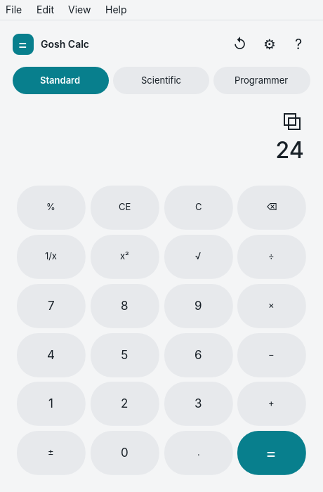
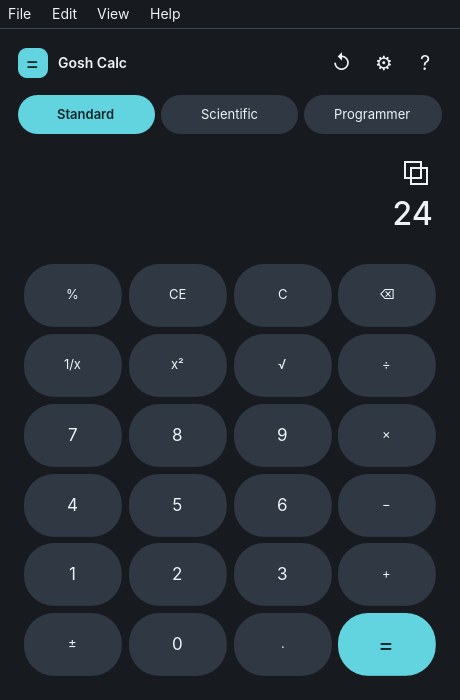
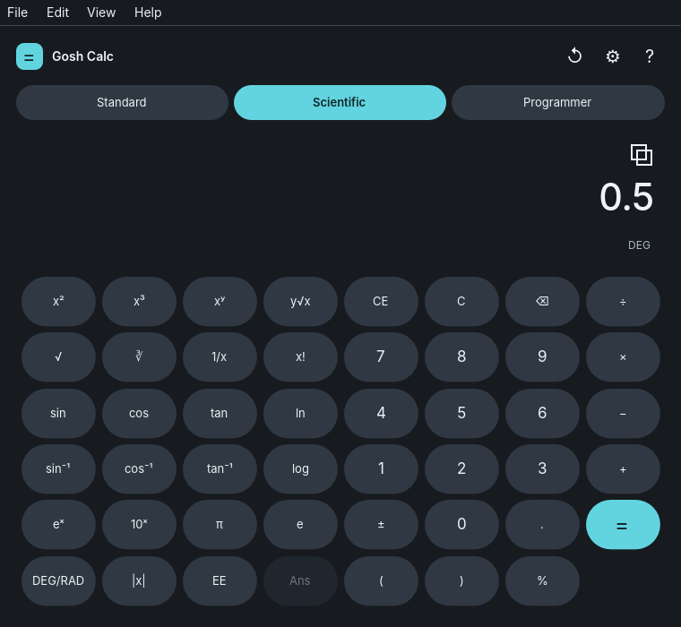

# Gosh Calc

A desktop calculator with standard, scientific and programmer modes, built with
[Godot Engine](https://godotengine.org) 4.7 and GDScript. It keeps Gosh Calc's
keyboard workflow, pill keys, cyan accent and calculation history.

**0.3.0-alpha.1 is a rewrite preview** (the previous 0.2 preview was Rust +
Dioxus, 0.1 was libcosmic). Linux builds have been run and tested; Windows and
macOS packages build but have **not** been run on those systems yet. See
[PLATFORM_SUPPORT.md](PLATFORM_SUPPORT.md). Do not treat this as a validated
stable release on every platform.





The images are captures of the running Godot application, not mockups.

## Features

- Standard arithmetic with precedence, repeat equals, contextual percent,
  reciprocal, square and square root.
- Scientific powers, roots, factorial, logarithms, exponentials, trigonometry,
  inverse trigonometry, DEG/RAD, π/e, EE, Ans and parentheses.
- Exact signed 64-bit programmer arithmetic, HEX/DEC/OCT/BIN conversion,
  bitwise operations and shifts. Invalid digits are disabled.
- Up to 100 persistent history entries, recall and copy result.
- Menus, keyboard shortcuts, settings and About; System, Light and Dark themes
  (System follows the OS live); persistent window size and maximized state.
- Existing 0.2 settings files are read as they are; old Linux libcosmic mode,
  angle and history are imported automatically with backups.

Standard/scientific calculations use IEEE doubles and display up to 12
significant digits; this is not a symbolic or arbitrary-precision calculator.
Programmer operations use exact `int64`. Unary functions act immediately on the
current entry. English is the only shipped language.

## No regressions, and how that is checked

The calculation engine, command layer, keyboard map and persistence are a
line-by-line port of the Rust implementation, verified against it rather than
assumed equal:

- **Differential testing against the Rust release.** About 2.6 million
  randomized steps (calculator-style typing, chaos input, programmer-mode
  overflow edges, scientific functions, history/recall with hostile data,
  limits) were replayed through both implementations, comparing the *whole*
  application state after every step: zero mismatches. A 166,000-step subset is
  committed as a golden corpus (`tests/golden`) and runs in the test suite.
- **Exact numerics.** Godot's own float parsing/printing is not correctly
  rounded, so decimal↔binary64 conversion is implemented exactly (50,016
  `fmt_f64` and 30,027 parse cases match Rust / Python bit for bit).
- **Settings compatibility.** `settings.json` files written by the Rust release
  load unchanged and re-save byte-identically; int64 history values above 2^53
  stay exact.
- **UI checks.** 120 end-to-end checks drive the real scene with synthesized
  mouse clicks and key events at 100% and 200% scale.

## Install a preview artifact

Download packages from the
[Releases page](https://github.com/goshitsarch-eng/Gosh-Calc/releases) only if
they appear there, and verify `SHA256SUMS`. `scripts/export.sh` builds them.

- **Linux:** extract `gosh-calc-<version>-linux-<arch>.tar.gz` and run
  `./gosh-calc`. It is a single self-contained executable (no WebKit/GTK
  needed); it needs X11 or Wayland and OpenGL (or Mesa software rendering).
- **Windows x86_64:** extract the `.zip` and run `Gosh Calc.exe`. *Not run on
  Windows yet.* There is no MSI in this series.
- **macOS:** extract the `.zip` and move `Gosh Calc.app` to Applications. It is
  unsigned and not notarized; Gatekeeper will ask you to confirm. *Not run on
  macOS yet.*
- **Flatpak:** `flatpak/dev.goshapps.calc.yml` packages the Linux export as a
  local bundle. *Not built or run yet.* See [BUILDING.md](BUILDING.md).

## Development

Install [Godot 4.7.2](https://godotengine.org/download/archive/4.7.2-stable/)
(standard build, no .NET) and run:

```sh
godot --path .                 # run the app
scripts/test.sh                # unit + golden + settings + UI checks
godot --headless --path . -s tests/run_all.gd   # display-free tests only
```

`Ctrl` is the primary shortcut modifier on Windows/Linux and `Command` on
macOS. Enter/= evaluates, Esc clears, Delete is CE, Backspace edits, primary+C
copies, Ctrl+H (Command+Shift+H on macOS) toggles history, primary+1/2/3 select
modes, primary+comma opens settings and F1 shows the shortcut guide. Shifted
operators work normally; in scientific mode `p` inserts π and in programmer HEX
mode A–F enter digits.

Settings live in the standard OS configuration directory under
`dev.goshapps.calc/settings.json` (the same place as 0.2). Malformed settings
are backed up; unknown schema versions and oversized files are preserved with
saving disabled. `GOSH_CALC_CONFIG_DIR` selects an isolated directory (used by
tests). Godot reserves `--help`/`--version` for itself; use
`gosh-calc -- --version` for the application's. `GOSH_CALC_SCALE=2` forces a UI
scale.

Architecture: [ARCHITECTURE.md](ARCHITECTURE.md). Contribution and QA guidance:
[CONTRIBUTING.md](CONTRIBUTING.md). Security: [SECURITY.md](SECURITY.md).
Licenses: [MIT](LICENSE), bundled components in
[THIRD_PARTY_LICENSES.md](THIRD_PARTY_LICENSES.md).
